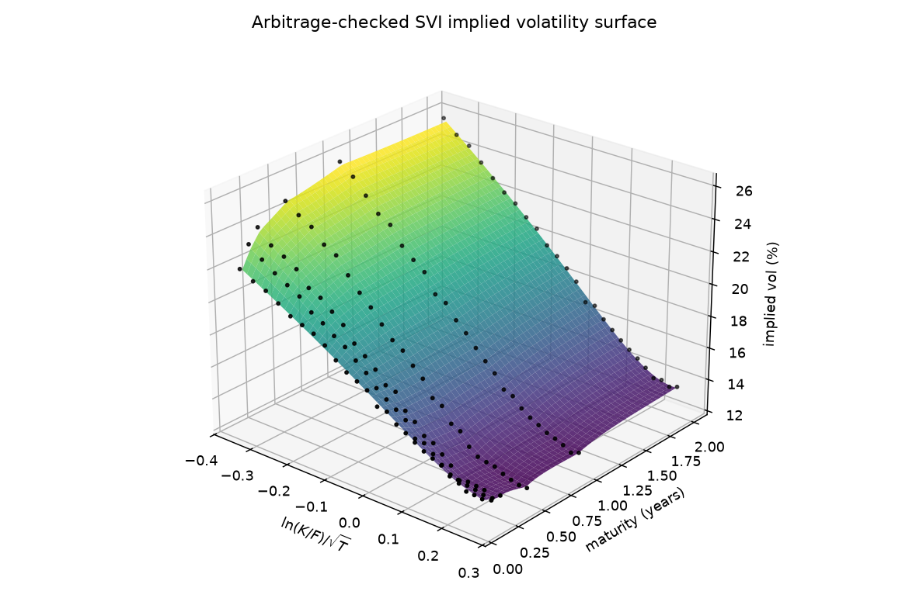
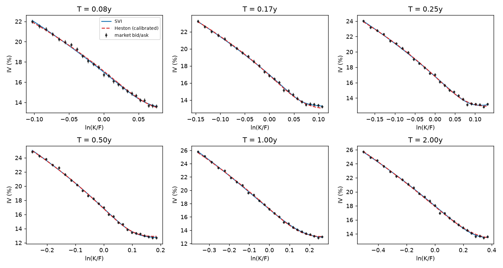
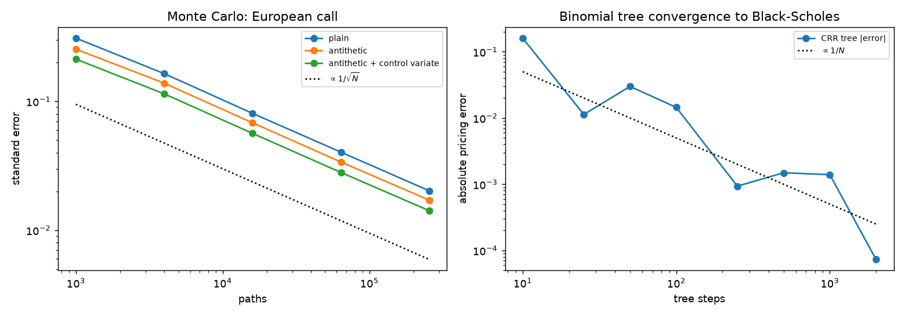

# volsurf

[](https://github.com/saamaaraiii/volsurf/actions/workflows/ci.yml)


Option pricing and implied volatility surfaces in Python. It prices options four different ways, fits an SVI volatility surface to an option chain (and checks it for arbitrage), and calibrates the Heston stochastic volatility model. There's a Streamlit dashboard on top for poking at it.



## What's in here

There are four pricers, and the tests make them check each other:

- Black-Scholes-Merton, with analytic Greeks
- a Cox-Ross-Rubinstein binomial tree (European and American)
- Monte Carlo with antithetic and control variates
- Heston (1993), priced by Fourier inversion

The implied vol solver is a vectorised Newton-Raphson that falls back to bisection whenever a Newton step would leave the bracket. Plain Newton blows up on deep in- or out-of-the-money options, and this doesn't.

For the surface, each expiry gets an SVI fit. Durrleman's condition (no butterfly arbitrage) and increasing total variance (no calendar arbitrage) are enforced while fitting, then checked again afterwards.

The Heston calibration is the part I'm happiest with. On a chain generated from known parameters plus quote noise, it gets ρ and v₀ back exactly and κ, θ, σ to within about 1%, in under half a second. Pricing a 150-option chain takes ~8 ms.

There are 30 tests: textbook values, Greeks against finite differences, put-call parity, the Heston pricer against SciPy's adaptive quadrature (to 1e-8), Monte Carlo landing inside its confidence interval, and calibration recovering the true parameters.

## The pipeline

```
option chain (bid/ask)  ──►  implied vols  ──►  SVI fit per expiry  ──►  arbitrage checks  ──►  surface
                                   │                                                          (interpolated in
                                   └──────────────►  Heston calibration  ◄── Fourier pricer    total variance)
```

```python
from volsurf import build_surface, heston
from volsurf.data import synthetic_chain, yahoo_chain

chain = synthetic_chain()  # or yahoo_chain("SPY") for live data (market hours)
surf = build_surface(chain)
print(surf.summary())  # SVI params and fit error per expiry
print(surf.butterfly_arbitrage_free, surf.calendar_arbitrage_free)
print(surf.implied_vol([95, 100, 105], T=0.75))

q = surf.quotes
fit = heston.calibrate(chain.attrs["spot"], q.strike, q["T"], q.iv, r=0.04, q=0.013)
print(fit.params, fit.rmse_iv_bp)
```

## Results

`python examples/full_pipeline.py` reproduces everything in this section.

### Smile fits



The chain here is synthetic on purpose: 150 OTM options over 6 expiries (1 month to 2 years), generated from Heston with 15bp of noise on each mid vol and a 40bp bid-ask spread. Because I know the true parameters, I can check whether the calibration actually finds them. Live Yahoo data works too (see the dashboard), but you can't grade a calibration without knowing the answer.

| Expiry | SVI fit error (bp) | No butterfly arbitrage |
|---:|---:|:---:|
| 1M | 11.7 | ✓ |
| 2M | 10.1 | ✓ |
| 3M | 14.2 | ✓ |
| 6M | 13.8 | ✓ |
| 1Y | 10.8 | ✓ |
| 2Y | 12.6 | ✓ |

No calendar arbitrage across expiries either. The fit errors sit right around the 15bp noise floor, so the fit follows the smile without chasing the noise.

### Heston calibration

| Parameter | Meaning | Fitted | True |
|---|---|---:|---:|
| κ | mean-reversion speed | 1.8189 | 1.8000 |
| θ | long-run variance | 0.0447 | 0.0450 |
| σ | vol of vol | 0.5442 | 0.5500 |
| ρ | spot/vol correlation | −0.7200 | −0.7200 |
| v₀ | current variance | 0.0300 | 0.0300 |

IV RMSE is 14.0bp, and it converges in 7 model evaluations (0.4s). The objective is vega-weighted price error. To first order that's the same as implied-vol error, but it saves inverting Black-Scholes on every iteration.

### Pricers side by side

| Method (S=100, K=105, T=0.5, r=4%, q=1%, σ=25%) | Price | Std. error |
|---|---:|---:|
| Black-Scholes (closed form) | 5.5482 | – |
| CRR binomial, 2,000 steps | 5.5482 | – |
| Monte Carlo, plain (256k paths) | 5.5024 | 0.0202 |
| Monte Carlo, antithetic (256k) | 5.5294 | 0.0171 |
| Monte Carlo, antithetic + control variate (256k) | 5.5316 | 0.0142 |

The variance reduction pays off most on the arithmetic Asian call, which has no closed form. Plain MC gives 6.4093 ± 0.0434. Using the geometric Asian (which does have a closed form) as a control variate gives 6.3563 ± 0.0015, about 30x tighter for the same number of paths.



## Dashboard

```bash
pip install -e ".[app]"
streamlit run app/streamlit_app.py
```

You can use a synthetic chain (with sliders for the true Heston parameters) or a live Yahoo Finance ticker. It shows the 3D surface, each smile with the SVI and Heston fits, the calibration report, and a pricer comparing every method plus the Greeks at the surface's implied vol.

## Implementation notes

The Heston characteristic function uses the "little Heston trap" form from Albrecher et al. (2007), which keeps the complex log continuous at long maturities.

Getting the Heston pricer accurate took a couple of goes. Integrating over log-strike makes the integrand oscillate at a frequency of roughly ln(K), and fixed quadrature can't keep up, so I integrate over log-moneyness instead. Very short expiries were still off, because the characteristic function decays slowly there, so each option now gets its own integration cut-off based on that decay rate.

SVI's objective isn't convex, so every slice is fitted from 18 starting points. The no-arbitrage conditions go in as penalties on a fine strike grid. Expiries are fitted in order, and each one is kept above the previous one in total variance.

Between expiries the surface is interpolated linearly in total variance, which keeps it free of calendar arbitrage.

## Layout

```
src/volsurf/
  black_scholes.py   prices, Greeks, vectorised implied vol
  trees.py           CRR binomial (European / American)
  monte_carlo.py     GBM and Asian MC with variance reduction
  heston.py          characteristic function, Fourier pricer, MC, calibration
  svi.py             raw SVI, Durrleman condition, calendar check
  surface.py         chain → arbitrage-checked surface
  data.py            synthetic Heston chains, Yahoo Finance loader
app/streamlit_app.py the dashboard
examples/            full pipeline + the charts above
tests/               30 tests
```

## References

- Black, F. & Scholes, M. (1973). *The pricing of options and corporate liabilities*. JPE.
- Cox, J., Ross, S. & Rubinstein, M. (1979). *Option pricing: a simplified approach*. JFE.
- Heston, S. (1993). *A closed-form solution for options with stochastic volatility*. RFS.
- Albrecher, H. et al. (2007). *The little Heston trap*. Wilmott Magazine.
- Gatheral, J. (2006). *The Volatility Surface: A Practitioner's Guide*. Wiley.
- Gatheral, J. & Jacquier, A. (2014). *Arbitrage-free SVI volatility surfaces*. Quantitative Finance.
- Lord, R., Koekkoek, R. & van Dijk, D. (2010). *A comparison of biased simulation schemes for stochastic volatility models*. Quantitative Finance.
- Glasserman, P. (2003). *Monte Carlo Methods in Financial Engineering*. Springer.
